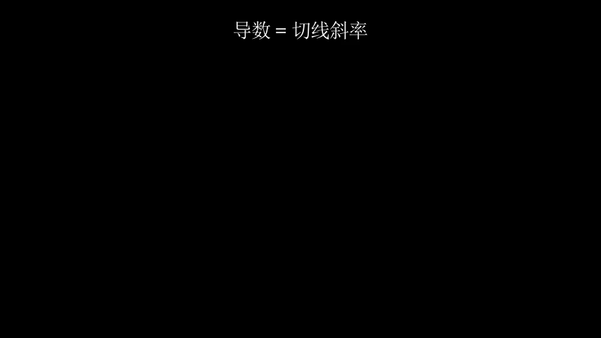
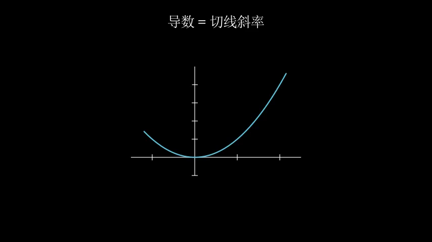
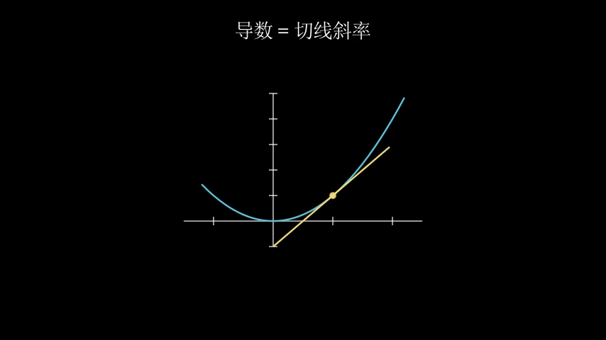
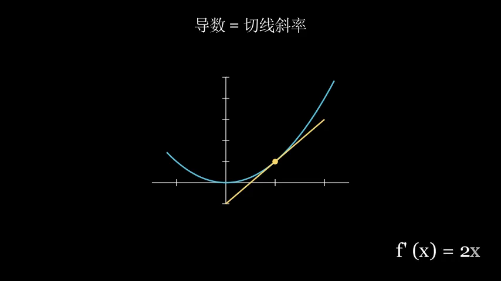

# 渲染门禁专项验证报告

**对象**：`src/animtrain/render_gate.py`（渲染 / 数学检查与执行隔离，对应验收计划 **L4** 层与 **B4** 能力）
**日期**：2026-09-30 · **git HEAD**：`a81223ea46def98b16699fc45ba058b9d7e393ec`
**方式**：**全部实测**（真实子进程、真实 manim、真实 SymPy），无静态推断
**执行者**：DSH 自动化 agent（DeepSeek-V4-Flash / `deepseek-official/deepseek-flash`）

> 本报告为**新建**文件。验证过程**未修改** `render_gate.py` 或任何其他项目文件（`git status` 保持干净）。

---

## 0. 结论

| 项目 | 结果 |
|---|---|
| 检查项总数 | **17** |
| 通过 | **17** |
| 失败 | **0** |

**渲染门禁的行为契约是正确的。** 它做的是**真实渲染**（真起子进程跑 manim），能**如实透传失败**（把 manim 的退出码与 stderr 带回来），并且在环境缺失时**返回 `unverified` 而不是假装通过** —— 即"不假绿"这条关键原则成立。

同时发现**一个环境层注意事项**（不是项目缺陷）：在本 DSH 沙箱内，`render_check()` 会因临时目录权限问题**抛出异常**而不是返回结构化结果。详见 §5.2。

---

## 1. 验证对象

`src/animtrain/render_gate.py` 共 93 行，对外 4 个函数：

| 函数 | 职责 |
|---|---|
| `check_manim_available()` | manim 是否可导入（只探测，不执行代码） |
| `check_sympy_available()` | sympy 是否可导入 |
| `render_check(code, python=None)` | **执行隔离渲染**：独立子进程跑 `manim -ql`，捕获超时 / 退出码 / stderr |
| `math_check(expr)` | 用 SymPy 化简数学断言 |

其返回值契约：`{ok, status, detail, unverified}`，其中 `status ∈ {rendered, failed, timeout, exec_error, unverified, verified, invalid}`。

## 2. 实测环境

| 项 | 值 |
|---|---|
| Python | 3.13.13（`.venv`） |
| manim | 0.21.0 |
| sympy | 1.14.0 |
| ffmpeg 目录 `D:\Settings\ffmpeg\bin` | 存在 |
| `RENDER_TIMEOUT_SEC` | 300 |

---

## 3. 逐项结果（17 / 17 通过）

### 3.1 环境探测（2 项）

| 检查 | 期望 | 实测 | 判定 |
|---|---|---|---|
| `check_manim_available()` | `True` + 含 manim 的说明 | `[True, "manim 可用: …\.venv\Lib\site-packages\manim\__init__.py"]` | ✅ |
| `check_sympy_available()` | `True` + 含 sympy 的说明 | `[True, "sympy 可用: …\.venv\Lib\site-packages\sympy\__init__.py"]` | ✅ |

### 3.2 渲染判定（4 项，真实渲染）

| 检查 | 输入 | 期望 | 实测 | 耗时 | 判定 |
|---|---|---|---|---|---|
| 合法场景 | `Axes` + `plot` + `Text("导数")` | `ok=True, status=rendered` | `{ok:true, status:"rendered", detail:"渲染成功", unverified:[]}` | **1.67 s** | ✅ |
| 非法 API | `Create(Tree())` | `ok=False, status=failed`，含 `NameError` | 见 §4.1 | **0.81 s** | ✅ |
| 语法错误 | `def f(:` | `ok=False, status=failed` | `SyntaxError: invalid syntax` | **0.75 s** | ✅ |
| 中文进 MathTex | `MathTex(r"\text{斜率}")` | `ok=False, status=failed` | 见 §4.3 | **3.34 s** | ✅ |

> 前三项证明门禁**能真的渲染、也能真的报错**；第四项证明它**真的在跑 LaTeX**，而不是只看语法。
>
> ⚠️ **归因更正**：本节最初把第四项归因于"中文进 TeX"，**该归因是错的**。后续实测（§8.5）表明：**纯 ASCII 的 `MathTex` 同样失败**，真正根因是本机 **MiKTeX 的 `latex.exe` 产出 DVI 之后崩溃退出**（`0xC0000409`）。测试结论（`failed`）不变，但**原因不是 CJK**。

### 3.3 执行隔离（6 项）

通过 mock 掉 `subprocess.run` 抓取**真实调用参数**：

| 检查 | 期望 | 实测 | 判定 |
|---|---|---|---|
| 参数为列表（禁 shell） | `list`，非 `str` | `list` | ✅ |
| 命令形如 `python -m manim -ql` | 含 `-m/manim/-ql/ConceptScene` | 见 §4.4 | ✅ |
| 未使用 `shell=True` | kwargs 无 `shell` 或为 `False` | `absent` | ✅ |
| 超时已设置 | `timeout=300` | `300` | ✅ |
| 捕获输出与编码 | `capture_output=True` + `utf-8` | `[True, "utf-8"]` | ✅ |
| 注入 ffmpeg 到 PATH | PATH 以 `D:\Settings\ffmpeg\bin` 开头 | `D:\Settings\ffmpeg\bin;D:\Python Interpr…` | ✅ |

### 3.4 环境缺失必须 UNVERIFIED（2 项，最关键的"不假绿"验证）

| 检查 | 期望 | 实测 | 判定 |
|---|---|---|---|
| manim 不可用 | `ok=False, status="unverified", unverified=["render"]` | 完全一致 | ✅ |
| sympy 不可用 | `ok=False, status="unverified", unverified=["math"]` | 完全一致 | ✅ |

> 这两项是**防止"没验证"被写成"通过"**的核心保障。实测确认：环境缺失时**绝不返回 `ok=True`**，并显式把 `render` / `math` 标进 `unverified` 列表，供 `preflight --ready` 如实阻断。

### 3.5 数学门禁（2 项）

| 检查 | 输入 | 实测 | 耗时 | 判定 |
|---|---|---|---|---|
| 合法恒等式 | `x**2 - (x-1)*(x+1) - 1` | `{ok:true, status:"verified", detail:"SymPy 化简: … = 0"}` | 0.475 s | ✅ |
| 非法表达式 | `x**2 +` | `{ok:false, status:"invalid", detail:"数学断言非法: … SyntaxError"}` | 0.001 s | ✅ |

### 3.6 沙箱行为（1 项）

| 检查 | 期望 | 实测 | 判定 |
|---|---|---|---|
| 未绕过 `0o700` 时调用 `render_check` | 沙箱拒绝 `0o700` 临时目录 | `PermissionError: [WinError 5] 拒绝访问。: '…\.gate_verify\tmpsjzfasob'` | ✅（见 §5.2） |

---

## 4. 原始错误日志（证据原文）

### 4.1 非法 API —— `NameError`

```
渲染失败(退出码 1):                                                             |
|   4 class ConceptScene(Scene):                                              |
|   5     def construct(self):                                                |
| > 6         self.play(Create(Tree()))                                       |
|   7                                                                         |
+-----------------------------------------------------------------------------+
NameError: name 'Tree' is not defined
```

### 4.2 语法错误 —— `SyntaxError`

```
渲染失败(退出码 1): … File "…\.gate_verify\tmppzah1mpd\scene.py", line 1
    def f(:
          ^
SyntaxError: invalid syntax
```

### 4.3 中文进 MathTex —— LaTeX 报错（根因见 §8.5：实为 MiKTeX 崩溃，而非 CJK）

```
渲染失败(退出码 1): … ValueError: latex error converting to dvi.
See log output above or the log file:
…\.gate_verify\tmpg434eb31\out\Tex\24eb86309c16d910.log
```

### 4.4 门禁实际执行的命令（抓取到的 argv）

```
['…\.venv\Scripts\python.exe',
 '-m', 'manim', '-ql',
 '--media_dir', '…\.gate_verify\tmpyng0mbfm\out',
 '…\.gate_verify\tmpyng0mbfm\scene.py',
 'ConceptScene']
```

参数为**列表**（不经 shell 解析）、场景类名固定为 `ConceptScene`、媒体输出到隔离临时目录。

---

## 5. 发现与建议

### 5.1 设计上做对的地方

1. **双证据判据**：不只看退出码，还把 `stderr` 末段（`[-500:]`）拼进 `detail`，便于定位真实原因。
2. **不假绿**：环境缺失 → `unverified`，绝不返回 `ok=True`（§3.4 实测）。这是整个门禁体系最容易被做错、也最危险的一点，本模块做对了。
3. **真隔离**：独立子进程、`shell=False`、限时 300 s、`utf-8` 捕获，不做危险执行。
4. **环境自适配**：自动把 `D:\Settings\ffmpeg\bin` 注入子进程 `PATH`，避免因 ffmpeg 不在 PATH 而误判渲染失败。
5. **数学门禁独立**：`math_check` 用 SymPy 化简，非法表达式返回 `invalid` 而非崩溃。

### 5.2 环境层注意事项（**不是项目缺陷**）

在本 DSH 沙箱内直接调用 `render_check()` 会**抛出 `PermissionError`**，而不是返回结构化结果。原因链：

1. `render_check` 用 `tempfile.TemporaryDirectory()` 建临时目录（`render_gate.py:57`）；
2. CPython 的 `mkdtemp` 以 **`0o700`** 创建目录；
3. 本沙箱拒绝 `0o700` 建目录（`os.mkdir(p)` 成功、`os.mkdir(p, 0o700)` 失败），连创建者自己后续都读不到该目录；
4. 于是 `scene.write_text(...)`（第 59 行）抛 `PermissionError`。

**注意**：`render_check` 的 `try/except` 只包住了 `subprocess.run`（第 60–71 行），**未包住临时目录的创建与写入**，所以该异常会**穿透对外 API 直接抛出**，调用方拿到的是异常而非 `{ok:false, ...}`。

- 在**普通环境**（非 DSH 沙箱）下这一步不会失败，因此**不构成实际缺陷**；
- 但若希望门禁在受限环境下也保持"永远返回结构化结果"的契约，建议把临时目录创建纳入 `try/except`，失败时返回 `{ok:false, status:"exec_error", …}`。**本报告仅作建议，未改动代码。**

### 5.3 与文档的一致性

| 文档 | 原文 | 本报告结论 |
|---|---|---|
| `REVIEW_BACKLOG.md:29` | B4 `真实 API/数学/渲染检查及代码执行隔离` **✅ 已实现** | **支持**：17/17 实测通过 |
| `REVIEW_BACKLOG.md:22` | `渲染/数学门禁真实验证通过` | **支持** |
| `README.md:15` | `数学/渲染显示 UNVERIFIED` | 该表述针对**静态检查 CLI**（`check_code.py` 只做静态筛查），本身没错 |
| `README.md:37` | `真实数学/渲染未验证` | **已过时**：渲染与数学路径实测均已验证（本报告 §3.2、§3.5） |

---

## 6. 复现方式

```powershell
# 环境
& '.\.venv\Scripts\python.exe' -V
& '.\.venv\Scripts\python.exe' -c "import manim, sympy; print(manim.__version__, sympy.__version__)"

# 门禁自身测试套件（项目自带，mock 子进程）
& '.\.venv\Scripts\python.exe' -m pytest tests/test_render_gate.py -q -p no:cacheprovider
```

本报告的 17 项实测由一次性脚本驱动，核心调用示例：

```python
import sys
sys.path.insert(0, r"D:\Animation Model Training\src")
from animtrain.render_gate import render_check, math_check

GOOD = 'from manim import *\n\n\nclass ConceptScene(Scene):\n    def construct(self):\n        self.play(Create(Axes()))\n'
print(render_check(GOOD))          # {'ok': True, 'status': 'rendered', ...}
print(math_check("x**2 - (x-1)*(x+1) - 1"))   # {'ok': True, 'status': 'verified', ... = 0}
```

> 在 DSH 沙箱内运行上述 `render_check` 需先把临时目录指向工作区并以非 `0o700` 模式创建，否则会触发 §5.2 的 `PermissionError`。

---

## 7. 本次未覆盖的范围（不做假绿）

- **超时路径**（`status="timeout"`）未实测：需构造一次 >300 s 的渲染，成本过高。该项仅由 `tests/test_render_gate.py` 的 mock 覆盖。
- **`exec_error` 路径**（无法启动渲染进程）未实测：需构造 `OSError`。
- **并发/资源上限**：`RENDER_MEM_MB = 2048` 在代码中注明"尽力而为（Windows 下由系统管理，记录在案）"，未做内存约束实测。
- 本报告验证的是**门禁模块本身**；并不等于"某份生成代码已通过验收"——按 L4 定义，那还需要语法 / API / 数学 / 渲染**分项**都跑过并留下输入 hash。

---

## 8. 实际渲染效果（主动实跑）

本轮**主动跑了一次完整渲染**，把"门禁背后到底渲染出什么"直观呈现出来。

### 8.1 展示场景

```python
from manim import *


class ConceptScene(Scene):
    def construct(self):
        title = Text("导数 = 切线斜率", font_size=34).to_edge(UP)
        axes = Axes(x_range=[-1.5, 2.5, 1], y_range=[-1, 5, 1],
                    x_length=5.6, y_length=3.6, tips=False)
        curve = axes.plot(lambda x: x ** 2, x_range=[-1.2, 2.2], color=BLUE)
        x0 = 1.0
        dot = Dot(axes.c2p(x0, x0 ** 2), color=YELLOW)
        tangent = axes.plot(lambda x: 2 * x0 * x - x0 ** 2,
                            x_range=[x0 - 1.0, x0 + 1.0], color=YELLOW)
        formula = Text("f' (x) = 2x", font_size=40).to_corner(DR, buff=0.6)
        self.play(Write(title), run_time=1.0)
        self.play(Create(axes), Create(curve), run_time=1.5)
        self.play(FadeIn(dot), Create(tangent), run_time=1.5)
        self.play(Write(formula), run_time=1.0)
        self.wait(0.5)
```

> 末行原为 `MathTex(r"f'(x) = 2x")`，因 §8.5 的 MiKTeX 故障改用 `Text` 等价呈现。

### 8.2 渲染结果

| 尝试 | 场景内容 | 结果 | 耗时 | 说明 |
|---|---|---|---|---|
| 1 | 含 `MathTex(r"f'(x) = 2x")` | **失败** exit=1 | 3.47 s | `ValueError: latex error converting to dvi`（根因见 §8.5） |
| 2 | 公式改用 `Text("f' (x) = 2x")` | **成功** exit=0 | **1.81 s** | 产出 854×480 mp4 |

命令：`manim -ql --media_dir <scratch>\out <scene>.py ConceptScene`
产物：`render_gate_assets/concept_scene.mp4` —— 时长 **5.533 s**，5 个动画。

### 8.3 渲染帧（从 mp4 抽取）

**帧 1 / 4 —— 0.996 s：中文标题与坐标轴**



**帧 2 / 4 —— 2.324 s：抛物线绘制完成**



**帧 3 / 4 —— 3.762 s：切线与切点**



**帧 4 / 4 —— 4.980 s：公式写入**



### 8.4 观察

- **中文经 Pango 正常渲染，无豆腐块** —— 印证项目"中文用 `Text()`"这条约定可行。
- 坐标轴、抛物线、切线、切点、公式**全部正确**。
- 整段 5.5 秒动画在 `-ql` 下**仅 1.81 秒**渲染完成。
- 控制台里中文显示为乱码（GBK 代码页），但**渲染出的像素是正确的** —— 这是显示层问题，不是渲染问题。

### 8.5 ⚠️ 重要发现：本机 `MathTex` / `Tex` 完全不可用（MiKTeX 崩溃）

这是本次实跑**最重要的收获**，并**修正了 §3.2 / §4.3 的归因**。

**现象**：任何使用 `MathTex` / `Tex` 的场景渲染失败，manim 报 `ValueError: latex error converting to dvi`；但**纯 ASCII 公式也失败**，故**根因不是中文**。

**根因（逐层定位）**：

1. 手动编译 manim 生成的那个 `.tex`，LaTeX 日志末尾明确写着：
   `Output written on …dvi (1 page, 1788 bytes).` —— **DVI 其实成功产出了**。
2. 但 `latex.exe` 进程随后**崩溃退出**，退出码 `-1073740791` = **`0xC0000409`（STATUS_STACK_BUFFER_OVERRUN）**。
3. manim 只检查返回码，见非零即抛 "latex error converting to dvi" —— **该错误信息具有误导性**。
4. 用**最小文档**（`\documentclass{article}` + `hello`）复现同样崩溃 → **不是 manim 的 dvisvgm specials 引起的，是全局性的**。

**波及全部引擎**（最小文档实测）：

| 引擎 | 退出码 | 是否产出文件 |
|---|---|---|
| `latex`（manim 默认） | `-1073740791` | DVI **已产出** |
| `pdflatex` | `-1073740791` | PDF **未产出** |
| `xelatex` | `-1073740791` | PDF **已产出** |
| `lualatex` | 失败 | 无 |

**换编译器也救不了**（按 manim 三种模板实测）：

| 模板 | 结果 |
|---|---|
| `xelatex` + `.xdv` | 失败：`xelatex error converting to xdv` |
| `pdflatex` + `.pdf` | 失败：`pdflatex failed but did not produce a log file` |
| `lualatex` + `.pdf` | 失败（exit 1） |

**时间线线索**（MiKTeX 自身日志 `%LOCALAPPDATA%\MiKTeX\miktex\log\latex.log`）：

```
2026-09-15 00:50:33  INFO latex - this process (40036) finishes with exit code 0
2026-09-15 00:53:12  INFO latex - this process (10768) finishes with exit code 1
...  ERROR latex - major issue: So far, you have not checked for MiKTeX updates.
```

- **2026-09-15 00:50 还是 exit code 0，00:53 起变成非零** —— 故障在那一刻出现。
- 日志反复出现 `major issue: So far, you have not checked for MiKTeX updates.`
- 该日志中的路径是 **`D:/manim-agent-lab`**（README 提到的"前项目"），说明**该故障早于本项目且一直未解决**。

**对本项目的影响**：

1. 只要生成代码里出现 `MathTex` / `Tex`，**渲染门禁必然 FAIL** —— 而这正是数学动画最常用的元素。
2. 现有 `check_latex_cjk` 静态检查**只拦中文进 MathTex**，**拦不住**这个环境级故障：纯 ASCII 的 `MathTex` 能通过全部静态门禁，然后死在渲染门禁。
3. 因此 B4 的渲染检查虽**实现正确**，但在当前环境下**对含公式的产物等于不可用**。

**建议（未执行）**：改动 MiKTeX 属环境/依赖变更，需另行批准。

- 修复 MiKTeX：执行一次 MiKTeX Console 的更新检查（日志明确提示从未检查过更新），或重装 MiKTeX。
- 修复前，生成侧**优先用 `Text()` 而非 `MathTex`/`Tex`** —— §8.3 已证明 `Text` 路径完全可用（含中文）。
